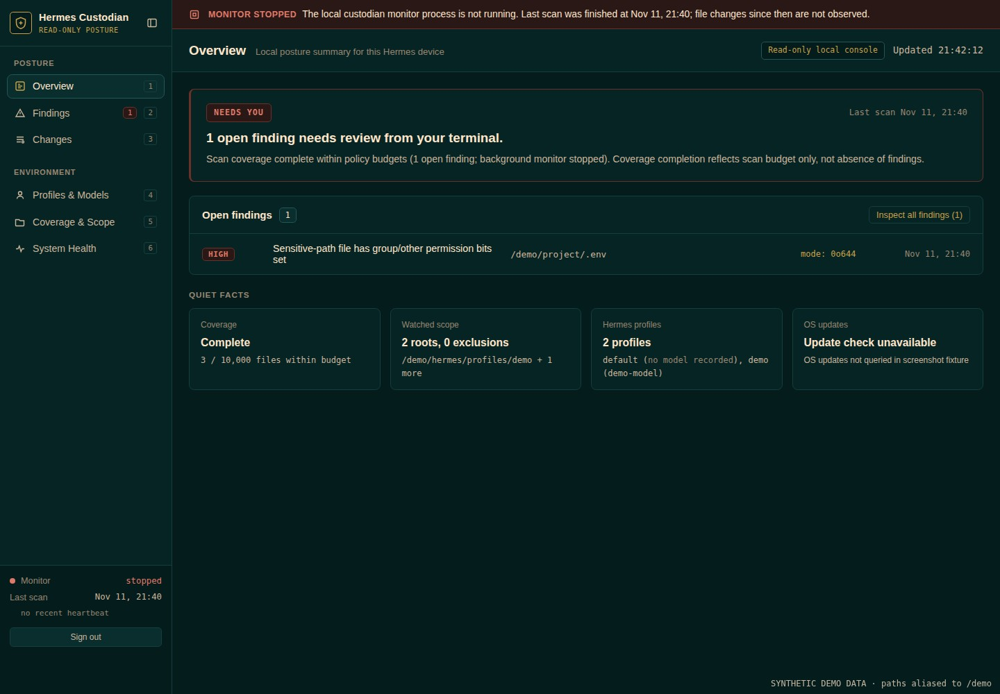
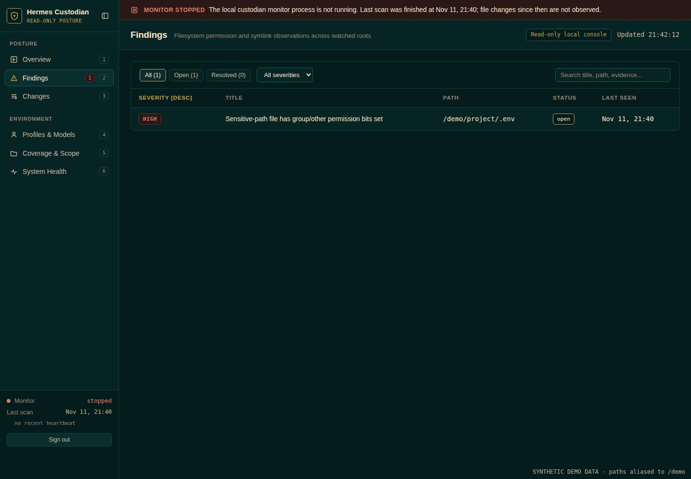
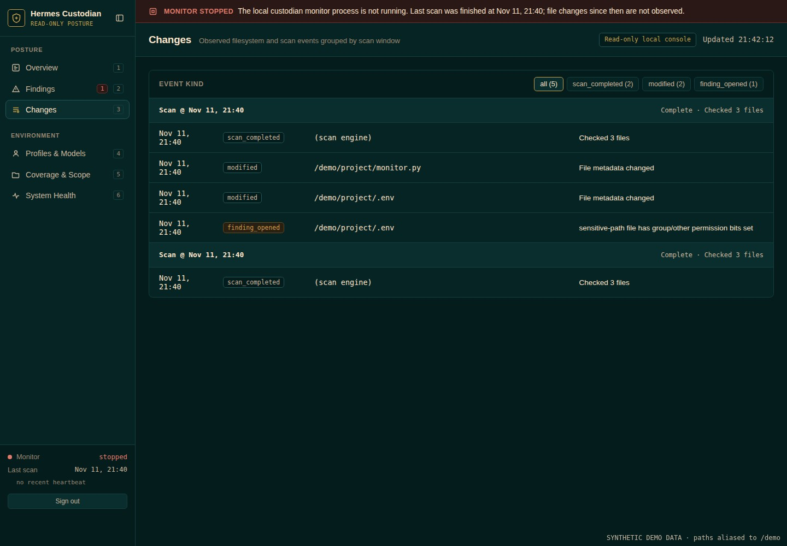

# Hermes Custodian

**Ask your Hermes agent: "what needs attention on this machine?" and get an answer backed by evidence.**

Hermes Custodian is a quiet watcher for the device your agent lives on. It remembers what your files and permissions looked like, notices when something changes, and shows you exactly what needs a look: in the terminal, in a local dashboard, or straight from your agent.

- **Your agent can check its own home.** Four read-only tools (`custodian_status`, `custodian_findings`, `custodian_changes`, `custodian_scan`) work on Linux, macOS and native Windows.
- **Every finding shows its evidence.** The path, what's wrong, when it was seen and what to do next. No vague scores, no black box.
- **It tells you what changed.** A persistent baseline turns "something is different" into a dated list.
- **You choose the scope.** Nothing is watched until you approve it in a first-run setup, and credential files, memory and chat history are never opened.
- **It admits its blind spots.** If a scan is incomplete or the store is unreadable, it says so instead of showing an empty, calm screen.
- **Private by design.** The dashboard runs on your machine only, behind a login. No telemetry, no cloud, no self-updater, and the AI can't give itself more power.

Setup is a guided first run. See [Installation and setup](#installation-and-setup).

Status: release candidate. The automated suite passes on GitHub-hosted Linux, macOS and Windows runners with Python 3.11, 3.12, 3.13 and 3.14, including native Windows plugin-tool and dashboard/discovery workflows. A hands-on installation on a user's Windows machine remains recommended. No antivirus, exploit detection or tamper-proof sandbox claim.

## Screenshots

Captured from the installed package using synthetic fixture data only (paths aliased to `/demo`); nothing here comes from a real machine.

**Overview**: what needs attention, coverage and monitor state.



**Findings**: evidence, severity and timestamps for each open finding.



**Changes**: what changed since the previous scan.



## Interfaces

- First-run terminal setup: explicit profile/path consent, monitoring limits and saved settings.
- Terminal control centre: evidence, changes and coverage.
- Background workload: bounded scans, persistent baselines, duplicate-instance protection and heartbeat.
- On-demand authenticated loopback web dashboard, focused on findings and changes—not a live agent-command feed.
- Four Hermes tools: status, findings, changes and scoped read-only scanning.
- Explicit user-level background-service management (systemd, launchd or Task Scheduler) and read-only OS update checks.

## Installation and setup

Python 3.11+ is required. Use the Python environment belonging to the Hermes installation that will load the plugin. The source/plugin entrypoint and the standalone CLI share one implementation; there is no separate Windows plugin or privileged agent process.

Linux / macOS, from this checkout:

```sh
python3 -m venv .venv
.venv/bin/python -m pip install -e '.[tui]'
.venv/bin/custodian setup
```

Windows PowerShell, from this checkout (no activation or execution-policy change required):

```powershell
py -3 -m venv .venv
.\.venv\Scripts\python.exe -m pip install -e ".[tui]"
.\.venv\Scripts\custodian.exe setup
```

These create an isolated CLI environment; they do not register the Hermes plugin automatically. The catalog submission is pending. For local plugin loading, follow your Hermes version's `hermes plugins install --help` and use the source directory containing `plugin.yaml` and `__init__.py`. A wheel installs the standalone CLI and its assets, not the repository-root Hermes entrypoint.

When using a named Hermes profile, set `HERMES_HOME` to that profile before setup and subsequent CLI launches so the agent tools and the app use the same state. First-run setup asks for discovery/scope consent and offers to create the dashboard login; it does not install or start a background service. Choose only the paths you want monitored, save, and run a scan. The TUI and dashboard show the same findings and history as the agent tools.

CLI commands (use the `.venv` executable path above if the environment is not activated):

```sh
custodian setup
custodian tui
custodian scan
custodian status
custodian findings
custodian events
custodian monitor
custodian dashboard
custodian updates
custodian updates security-plan --enable
custodian updates security-plan --disable
custodian updates security-apply --plan-id <PLAN_ID> --enable
custodian service status
custodian service install --enable
custodian service start
custodian service stop
custodian service uninstall
```

Setup/TUI require a real interactive terminal. Unattended launches do not hang on an onboarding prompt. Monitoring and dashboard operation require completed setup. Service installation and enablement do not start the workload implicitly; use `custodian service start` to start the installed unit explicitly. User services start with the user manager; boot-before-login persistence is not promised without administrator-managed user-manager lifecycle. `custodian updates security-plan --enable|--disable` previews native Debian/Ubuntu security-only `unattended-upgrades` policy (`Automatic-Reboot "false"`) without writing files. `custodian updates security-apply --plan-id <PLAN_ID>` is admin-only: it requires real and effective root (`uid=0, euid=0`) running from a root-owned installation (never `sudo` from a user-writable checkout/venv), re-verifies `plan_id`, prompts interactively on the terminal for `'APPLY SECURITY POLICY ' + PLAN_ID` (no `--yes`/`--approve` flags), and is never exposed through AI plugin tools or the web dashboard. Live root policy application and reboot behaviour were not executed in test verification.

When launched with `HERMES_HOME`, state follows that profile under `plugin-data/hermes-custodian/`. Otherwise the standalone CLI uses `$XDG_STATE_HOME/hermes-custodian` (fallback `~/.local/state/hermes-custodian`) on Linux, `~/Library/Application Support/hermes-custodian` on macOS, or `%LOCALAPPDATA%\hermes-custodian` on Windows. Use the global `--state-dir /absolute/path` option before the command to select an explicit state directory. Keep each profile's ownership and scope deliberate. The plugin never automatically opens another profile's state.

The web dashboard binds to 127.0.0.1 only and signs in with a username and password you set once, like Hermes's own basic dashboard login. First-run `custodian setup` offers to create it when you finish; set or reset it any time with `custodian dashboard-credentials` (masked prompts, never a command-line flag, minimum 12 characters). Only a salted scrypt verifier is stored, in a private file in the state directory; sessions expire, are bound to the current password, and failed logins are rate-limited. This is a single shared local login with no MFA, intended for loopback use. For remote access, use SSH forwarding; no public listener or tunnel is installed.

## Scope and limitations

- Linux, macOS and native Windows are tested. The background-service adapters use systemd user services, LaunchAgents or per-user Task Scheduler tasks respectively; startup behavior depends on the user's login/session and OS permissions. No service is installed implicitly.
- Credential files are checked as metadata only: no `.env`, OAuth stores, private keys or browser credential contents are loaded into the AI or hashed for integrity.
- Only admitted, non-sensitive, singly-linked `.py` and `.md` files receive content fingerprints. Other selected file types receive metadata checks only. Sensitive directories (including private memory/history areas) are not enumerated. Symlinks and special files are never followed/read; scan limits and errors appear as incomplete coverage.
- File changes are not proof of malware. Findings carry their evidence and limitations.
- Same-user software cannot prevent an unrestricted same-user shell from changing its configuration, stopping it or rewriting state. This is not a sandbox or an EDR replacement.
- Linux update detection reads the local APT cache; macOS uses `softwareupdate -l`, and Windows queries the Windows Update COM search API. Native queries may contact OS/vendor services. They do not install updates, and availability or security classification may be unknown. Security-update policy preview/apply is Linux-only and separate from detection.
- This catalog plugin has no self-updater. Code updates must use Hermes's catalog SHA-pin/review process.
- No automatic reboot, service restart, privileged escalation, exploit execution or arbitrary command executor.
- The state folder must not be writable by other users. A group-writable parent (the 775 default on Ubuntu and Raspberry Pi OS) is accepted only when it is yours and its group has no other members. If other accounts, containers or services share that group, run `chmod g-w` on the parents or choose a state directory under a private (mode 700) parent with `--state-dir`.
- The dashboard session cookie is not port-scoped by browsers, so another local process listening on a different 127.0.0.1 port in the same browser could be sent it. The dashboard binds to loopback only, uses an HttpOnly, SameSite=Strict cookie, exact Host and Origin checks, a 12-hour idle and 14-day absolute session limit, and rate-limited sign-in. Treat the machine's local users as trusted.
- If the findings or events store cannot be read (for example a locked or corrupt database), the dashboard says so and shows degraded coverage instead of an empty list.

## Privacy and behaviour disclosures

The plugin registers tools without scanning files or starting processes at import time. Explicitly requested scans read selected regular files and metadata outside the plugin data directory; metadata inventory reads selected Hermes configuration, never private conversation/memory/personality files. No telemetry or cloud model calls are needed for monitoring. Stored local state contains paths, fingerprints, findings, redacted inventory and event history—not credential contents.

The user-service and native update adapters execute fixed argument-array subprocesses (systemctl/APT, launchctl/softwareupdate, or schtasks/PowerShell with a fixed Windows Update query), with timeouts and no shell command construction. The monitor is long-running only when explicitly launched/installed. The dashboard is a separate on-demand local process. Host configuration changes are never implied by installing or registering the plugin.

## Verification

```sh
.venv/bin/python -m pytest tests -q
hermes plugins doctor .
hermes plugins validate . --install-deps
```

Performance targets, not yet verified: monitoring below 100 MiB steady-state RSS and below 1% of one logical CPU while idle on a Pi 5. Dashboard server memory is measured separately. The monitor does not import Textual or run a web server, and never calls an AI model.

Catalog admission and a demo are separate release gates. A catalog PR is not approval or a guarantee of security.
